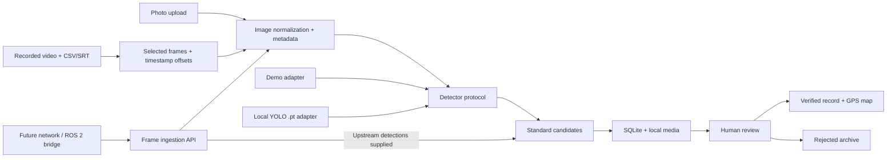

# Architecture and extension contract



## Model boundary

`Detector.predict(PIL.Image, threshold) -> list[Candidate]` returns class labels, confidence in `[0,1]`, and `[x1,y1,x2,y2]` pixel boxes in the EXIF-oriented frame. The detector imports no drone code. The registry chooses a saved model ID and loads a file only when selected. YOLO is optional and imported lazily. Model ID and name are copied into each detection so replacements never rewrite history.

To add another inference backend, implement the protocol, validate output using `Candidate`, and add a registry selection branch. No React or detection-table changes are needed for another YOLO .pt file; register its path and labels in Settings. Model file modification time invalidates the cached adapter on subsequent selection.

## Source boundary

`POST /api/ingest/frame` accepts multipart fields:

- `file`: JPEG/PNG/WebP/TIFF/BMP image bytes supported by Pillow.
- `envelope`: JSON matching `IngestEnvelope` in `backend/app/schemas.py`.
- Optional `X-Ingest-Token` header if `TURTLE_INGEST_TOKEN` is configured.

```json
{
  "source": "future-network-camera",
  "metadata": {
    "latitude": 35.9192,
    "longitude": -78.9628,
    "captured_at": "2026-10-18T10:32:00-04:00"
  },
  "model_id": "upstream-v2",
  "model_name": "Upstream turtle detector",
  "is_mock": false,
  "detections": [
    {"class_name": "turtle", "confidence": 0.93, "bounding_box": [300, 180, 650, 480]}
  ]
}
```

Omit `detections` or use `null` to run the active local engine. Supply `[]` to record a frame with no upstream candidates without running the engine. Supplied detections retain upstream scores and are not re-thresholded. Set `is_mock=true` for upstream simulation. Metadata may be `{}`; absent fields remain null. Coordinates must be paired and finite. Boxes must have positive area, be finite, and fit the image. Byte limits are enforced while reading.

An independent source adapter can repeatedly POST frames to this endpoint, with synchronized metadata. This contract does not open a camera, negotiate a video stream, use a DJI SDK, or provide backpressure. A future ROS 2 bridge or stream decoder owns transport, frame-rate control, reconnect behavior, and clock synchronization; it submits the same frame envelope.

Example with curl on Linux (use `curl.exe` and adapted paths on Windows):

```bash
curl http://127.0.0.1:8000/api/ingest/frame \
  -F 'file=@examples/generated/synthetic-turtle.jpg' \
  -F 'envelope=<examples/frame-envelope.json'
```

## Capture metadata

Capture times are stored as ISO strings so original offsets and unknown timezones survive SQLite round trips. Review/upload times are UTC strings. The UI converts known-offset capture times for display and marks timezone-less captures. Metadata provenance identifies each field source; missing fields and warnings are separate arrays.

Images use EXIF `DateTimeOriginal` and optional `OffsetTimeOriginal`, never file mtime. Manual capture metadata overrides embedded metadata. Recorded video uses known video tags or a manual recording-start timestamp plus actual `frame_index / fps`. The nearest external telemetry sample within the configured tolerance overrides only fields it supplies. Its absolute timestamp is shifted by the frame/sample difference. GPS is nearest-sample, never fabricated or interpolated. Frame provenance includes job ID, frame index, offset seconds, and fps.

Manual video GPS represents a constant provided location. Supply a trajectory CSV/SRT for changing frame coordinates. Video `creation_time` is tagged with its source and should be checked against the camera clock. Neither DJI Avata 2 GPS metadata nor subtitle export is assumed to be available.

## Storage and review

`CapturedImage` has many `Detection` records. Each candidate gets an independent crop/annotation and review status. The normalized full frame is stored once; uploaded original bytes are also retained as `source.bin` alongside it. Verification only updates the candidate status and review timestamp. Rejections retain all media for later analysis. `verified` records are sightings; they are not copied into another table.

Conditional SQL updates enforce valid transitions even when two requests race:

```text
pending -> verified
pending -> rejected
verified or rejected -> pending (explicit reset)
```

Every other transition returns HTTP 409. SQLite uses foreign keys, WAL, and a busy timeout. Settings, registered model paths, and video jobs persist in their own tables. New videos snapshot the chosen engine, threshold, frame interval, and limit so later settings changes do not alter a running job.

## Local execution

### Live preview boundary

`backend/app/streams.py` stores the chosen MediaMTX browser-player URL and WebRTC/HLS preference in a separate `live_sources` table. `GET/PUT /api/live-source` do not fetch a URL, probe a device, load a model, or start inference. Existing image/detection tables and models are independent of this configuration.

`frontend/src/LiveFeed.jsx` embeds the MediaMTX player only after an explicit Open preview click. Its status says Preview requested; an iframe load does not prove that a drone is connected or frames are playing. Stream errors remain in the MediaMTX player. Live inference and connection verification remain false. Recorded media and `/api/ingest/frame` retain their original behavior.

The user has Goggles N3 and Android. DJI documents wired USB-C live-view sharing to DJI Fly, while a publisher/capture bridge still needs to deliver that view to MediaMTX. See [the hardware-specific guide](LIVE_FEED.md) for the proposed integration path and its verification limits. Frame extraction from this cross-origin player is not used for inference.

### Readability

The interface uses relative text sizes and higher-contrast secondary text. The top-bar Text size control sets a 16/18/20 px root size and stores that preference only in this browser. Large (18 px) is the default. This display preference does not alter survey records or model settings.

The theme toggle sets `data-theme` on the root document. `themes.css` owns semantic light/dark colors for surfaces, copy and control states. Dark is the default. An early head script restores the browser's saved theme and text size before the first paint, and React keeps the theme-color metadata synchronized. Photo pixels are untouched; only the map tile styling follows the theme.

The Spotify-inspired composition uses a compact sidebar, neutral surfaces and rounded controls. Both themes retain separate accessible primary-button foreground/background pairs. Dashboard review actions stay visible on mobile. Leaflet zoom transitions are disabled to prevent callbacks after map teardown during quick navigation; resize observers are disconnected and movement is stopped when the map unmounts.

Frontend refreshes use revision numbers to discard snapshots started before a review or settings save. Explicit media refreshes queue behind an active poll. Failed statistics refreshes do not undo a successful review. User-entered capture times without a timezone stay naive and flagged; no browser timezone is guessed.

FastAPI serves the built React frontend and media. Video jobs run via background tasks; inference and image CPU work use worker threads. Frontend polling refreshes every five seconds while visible. There are no cloud model calls, model downloads, purchase flows, or DJI SDK dependencies. OpenStreetMap tiles and an explicitly opened MediaMTX player make browser requests outside the local app.

Real YOLO validation requires the user's trusted .pt weights and representative survey media. GPU optimization, live source adapters, durable task queues, migrations for future schema changes, deduplication across reprocessing jobs, and multi-user access control are independent future work.

## Implementation references

- [FastAPI multipart file uploads](https://fastapi.tiangolo.com/tutorial/request-files/)
- [FastAPI background tasks](https://fastapi.tiangolo.com/tutorial/background-tasks/)
- [Ultralytics prediction interface and box results](https://docs.ultralytics.com/modes/predict/)
- [Vite setup and runtime requirements](https://vite.dev/guide/)
