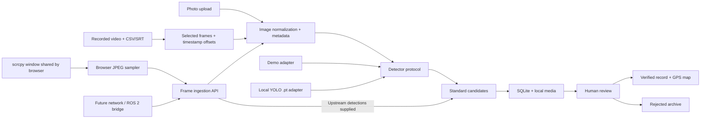

# Architecture and extension contract



## Model boundary

`Detector.predict(PIL.Image, threshold) -> list[Candidate]` returns class labels, confidence in `[0,1]`, and `[x1,y1,x2,y2]` pixel boxes in the EXIF-oriented frame. The detector imports no drone code. The registry chooses a saved model ID and loads a file only when selected. YOLO is optional and imported lazily. Model ID and name are copied into each detection so replacements never rewrite history.

To add another inference backend, implement the protocol, validate output using `Candidate`, and add a registry selection branch. No React or detection-table changes are needed for another YOLO .pt file; register its path and labels in Settings. Model file modification time invalidates the cached adapter on subsequent selection.

## Source boundary

`POST /api/ingest/frame` accepts multipart fields:

- `file`: JPEG/PNG/WebP/TIFF/BMP image bytes supported by Pillow.
- `envelope`: JSON matching `IngestEnvelope` in `backend/app/schemas.py`.
- Optional `X-Ingest-Token` header if `TURTLE_INGEST_TOKEN` is configured.

```json
{
  "source": "future-network-camera",
  "metadata": {
    "latitude": 35.9192,
    "longitude": -78.9628,
    "captured_at": "2026-10-18T10:32:00-04:00"
  },
  "model_id": "upstream-v2",
  "model_name": "Upstream turtle detector",
  "is_mock": false,
  "detections": [
    {"class_name": "turtle", "confidence": 0.93, "bounding_box": [300, 180, 650, 480]}
  ]
}
```

Omit `detections` or use `null` to run the active local engine. Supply `[]` to record a frame with no upstream candidates without running the engine. Supplied detections retain upstream scores and are not re-thresholded. Set `is_mock=true` for upstream simulation. Metadata may be `{}`; absent fields remain null. Coordinates must be paired and finite. Boxes must have positive area, be finite, and fit the image. Byte limits are enforced while reading.

An independent source adapter can repeatedly POST frames to this endpoint, with synchronized metadata when available. The Live feed page is one such adapter: it samples browser-shared scrcpy video and submits `{"source":"scrcpy-window","metadata":{},"frame_captured_at":"2026-11-06T12:34:56.789Z"}`, leaving absent GPS null and allowing the active local engine to run. The optional top-level `frame_captured_at` requires a timezone and is accepted only for `scrcpy-window`; other sources use original capture metadata as before. This contract does not open a camera, negotiate a video stream, use a DJI SDK, or provide backpressure. The browser sampler, future ROS 2 bridge, or other stream decoder owns transport, frame-rate control, reconnect behavior, and clock synchronization; each submits the same frame envelope.

Example with curl on Linux (use `curl.exe` and adapted paths on Windows):

```bash
curl http://127.0.0.1:8000/api/ingest/frame \
  -F 'file=@examples/generated/synthetic-turtle.jpg' \
  -F 'envelope=<examples/frame-envelope.json'
```

## Capture metadata

Capture times are stored as ISO strings so original offsets and unknown timezones survive SQLite round trips. Review/upload times are UTC strings. The UI converts known-offset capture times for display and marks timezone-less captures. Metadata provenance identifies each field source; missing fields and warnings are separate arrays.

Images use EXIF `DateTimeOriginal` and optional `OffsetTimeOriginal`, never file mtime. Manual capture metadata overrides embedded metadata. Recorded video uses known video tags or a manual recording-start timestamp plus actual `frame_index / fps`. The nearest external telemetry sample within the configured tolerance overrides only fields it supplies. Its absolute timestamp is shifted by the frame/sample difference. GPS is nearest-sample, never fabricated or interpolated. Frame provenance includes job ID, frame index, offset seconds, and fps.

Manual video GPS represents a constant provided location. Supply a trajectory CSV/SRT for changing frame coordinates. Video `creation_time` is tagged with its source and should be checked against the camera clock. Neither DJI Avata 2 GPS metadata nor subtitle export is assumed to be available.

## Storage and review

`CapturedImage` has many `Detection` records. Each candidate gets an independent crop/annotation and review status. The normalized full frame is stored once; uploaded original bytes are also retained as `source.bin` alongside it. Verification only updates the candidate status and review timestamp. Rejections retain all media for later analysis. `verified` records are sightings; they are not copied into another table.

Explicit rejected-photo deletion is the exception to default retention. `POST /api/images/delete-rejected` accepts a bounded list of image UUIDs after the UI lists the photos and asks for permanent-deletion confirmation. A SQLite writer lock precedes validation; every associated detection must still be rejected. Missing photos, active siblings, unsafe paths, or failed media staging abort the entire batch. Individual bulk reviews continue to use the existing conditional review endpoints; partial failures stay selected for retry.

Deletion moves unshared selected media into private `.deletion-staging/<batch>/` before removing database rows. A manifest maps staged filenames back to safe media-relative paths and records the selected image IDs. Failed precommit operations restore the media and roll back the rows. Committed deletions unlink the staged files; an OS cleanup failure returns success with `cleanup_pending=true`, retaining private bytes and the manifest for manual cleanup. Recovery after an interrupted process is manual: inspect the manifest and database before restoring any staged paths or removing committed deletion leftovers. Source videos, unrelated files, and media referenced by surviving records remain untouched. No recursive directory deletion is used.

Conditional SQL updates enforce valid transitions even when two requests race:

```text
pending -> verified
pending -> rejected
verified or rejected -> pending (explicit reset)
```

Every other transition returns HTTP 409. SQLite uses foreign keys, WAL, and a busy timeout. Settings, registered model paths, and video jobs persist in their own tables. New videos snapshot the chosen engine, threshold, frame interval, and limit so later settings changes do not alter a running job.

## Local execution

### Live capture boundary

`frontend/src/LiveFeed.jsx` requests a browser `getDisplayMedia` video stream only after the user selects **Share scrcpy window**. The desktop/browser picker chooses the scrcpy window; the website cannot select it silently or persist screen-sharing permission. The browser runs on the Ubuntu desktop that displays scrcpy and needs localhost, loopback, or HTTPS. No audio, relay server, DJI SDK, or network-video interface is assumed.

The returned stream is attached to a local video preview. Preview alone does not submit frames. **Start detection** enables a bounded sampler: capture one JPEG from the decoded video, POST it to `/api/ingest/frame`, then wait the remaining portion of the chosen start-to-start interval. Only one request is in flight; inference taking longer than the interval slows sampling without queuing stale frames. The default interval is five seconds and the default session limit is 60 frames. The optional **Ingest token** is under **Advanced connection settings**, held in page memory, and sent as `X-Ingest-Token`.

Frame encoding preserves the entire shared image and its aspect ratio. A scale of `min(1, 1920 / max(videoWidth, videoHeight))` caps the longest edge at 1920 pixels without enlarging smaller sources. The canvas encodes JPEG at quality 0.92; no automatic cropping removes phone controls, overlays, or borders.

Each envelope identifies `scrcpy-window` and supplies empty original-camera metadata plus the measured frame snapshot time. `new Date().toISOString()` is captured immediately before drawing the shared video frame onto the snapshot canvas, so encoding, HTTP delays, and model processing do not shift it. If original capture metadata is absent, the backend stores this value in `captured_at` with provenance `browser frame capture` and a clock/mirroring-delay warning. The inspector labels it **Live frame captured**, and CSV includes `capture_time_source`; it is not presented as original camera exposure time. Explicit upstream or EXIF original capture metadata wins. Missing/legacy frame timestamps remain null, and there is no backfill. GPS remains unknown unless actually supplied. The active detector chooses real or simulated inference, retains model/mock provenance, and preserves the sampled JPEG bytes as before.

Sampling stops on an error, frame limit, manual stop, track ending or muting, document visibility becoming hidden, or page teardown. Unmuting or returning to the visible tab does not restart detection automatically. Page teardown also releases capture tracks. A submitted frame may still finish on the server after a stop. A captured window is not proof of a current drone feed; the user checks the actual mirrored content. Phone controls and overlays remain in the captured image. See [the scrcpy guide](LIVE_FEED.md) for the workflow and Ubuntu capture limitations.

The previous `backend/app/streams.py`, `live_sources` table, and `GET/PUT /api/live-source` routes remain as legacy configuration compatibility. The current frontend neither reads them nor uses their saved player addresses. Their static connection/inference flags describe only that legacy configuration, not the browser's active capture session.

### Readability

The interface uses relative text sizes and higher-contrast secondary text. The top-bar Text size control sets a 16/18/20 px root size and stores that preference only in this browser. Large (18 px) is the default. This display preference does not alter survey records or model settings.

The theme toggle sets `data-theme` on the root document. `themes.css` owns semantic light/dark colors for surfaces, copy and control states. Dark is the default. An early head script restores the browser's saved theme and text size before the first paint, and React keeps the theme-color metadata synchronized. Photo pixels are untouched; only the map tile styling follows the theme.

The Spotify-inspired composition uses a compact sidebar, neutral surfaces and rounded controls. Both themes retain separate accessible primary-button foreground/background pairs. Dashboard review actions stay visible on mobile. Leaflet zoom transitions are disabled to prevent callbacks after map teardown during quick navigation; resize observers are disconnected and movement is stopped when the map unmounts.

Frontend refreshes use revision numbers to discard snapshots started before a review or settings save. Explicit media refreshes queue behind an active poll. Failed statistics refreshes do not undo a successful review. User-entered capture times without a timezone stay naive and flagged; no browser timezone is guessed.

FastAPI serves the built React frontend and media. Video jobs run via background tasks; inference and image CPU work use worker threads. Frontend polling refreshes every five seconds while visible. There are no cloud model calls, model downloads, purchase flows, or DJI SDK dependencies. Live capture stays between the desktop browser and local ingestion endpoint; OpenStreetMap tiles make browser requests outside the local app.

Real YOLO validation requires the user's trusted .pt weights and representative survey media. Ubuntu screen sharing and the actual DJI image require field validation. GPU optimization, other source adapters, durable task queues, migrations for future schema changes, deduplication across reprocessing jobs, and multi-user access control are independent future work.

## Implementation references

- [FastAPI multipart file uploads](https://fastapi.tiangolo.com/tutorial/request-files/)
- [FastAPI background tasks](https://fastapi.tiangolo.com/tutorial/background-tasks/)
- [Ultralytics prediction interface and box results](https://docs.ultralytics.com/modes/predict/)
- [Vite setup and runtime requirements](https://vite.dev/guide/)
- [Browser screen capture](https://developer.mozilla.org/en-US/docs/Web/API/MediaDevices/getDisplayMedia)
- [scrcpy wireless connections](https://github.com/Genymobile/scrcpy/blob/master/doc/connection.md)
